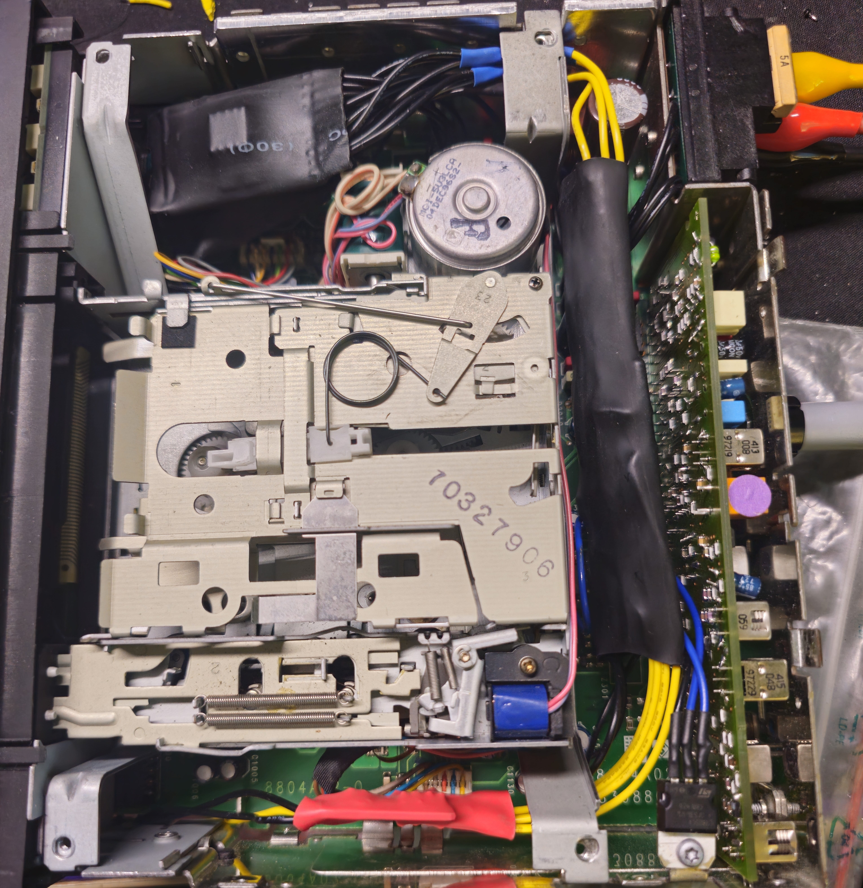
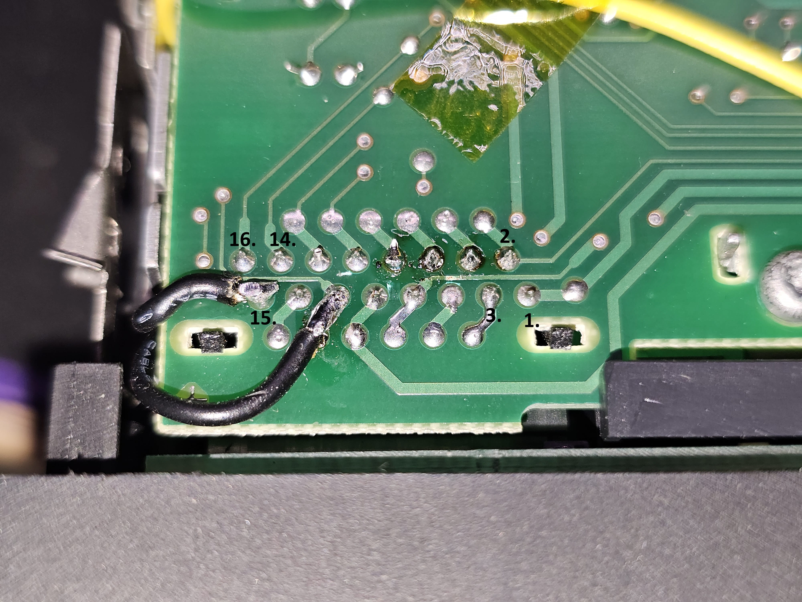
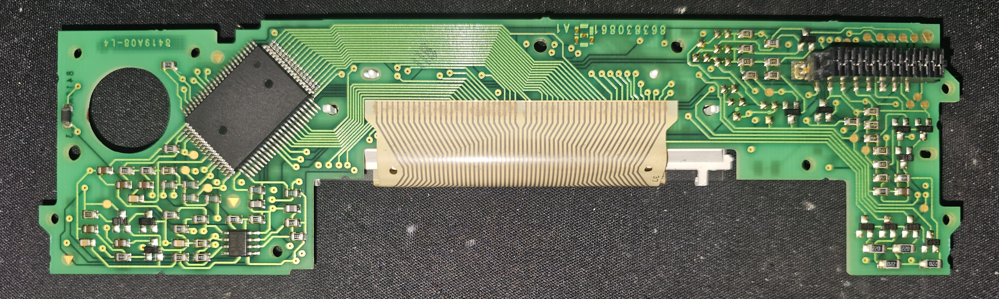
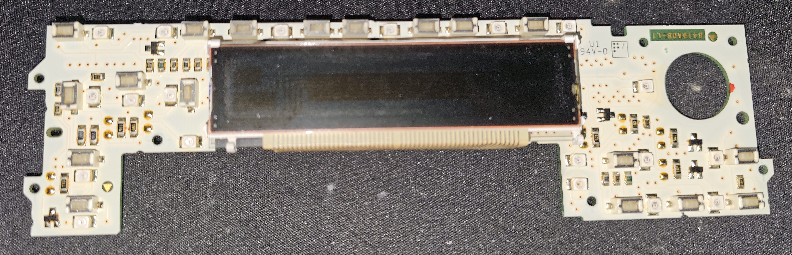

# BMW-Reverse-RDS-Bluetooth
BMW E36 Reverse RDS equiped with inner workings of ESP32, PCM5102, ADS1115 and TPA3116D2.

In the [WithoutDisplay](WithoutDisplay) folder is PlatformIO code for ESP32 (just, no S3 or anything due to a2dp), it uses:
- PCM5102 DAC to play act as BT music reciever
- ADS1115 ADC to get voltage state of volume potentiometer and button lines
  - A0 is the middle of volume pot, A1 is pin 11 of front panel connector (<II>), A2 is pin 15 (-TONE+ RDS TP)
- And then you can use TPA3116D2 to replace the amplifier chips
  - you need to cut them and solder different voltage potentional to the pull resistor due the radio working differently - on the photo, and the connector to the radio has to be changed like on described on the photo.

If you want to use the original radio switch chips (you can still replace the amps), you need to cut the mono like away from the AM section and wire in your AUX (good amount of tutorials on webs...)

## The display

The voltages for each button on the two pins are:
- Pin 11:
  - 1,685 M (Play/Pause)
  - 2,500 > (Next)
  - 0,85 < (Prev)
- Pin 15:
  - 0,865 TONE
  - 1,688 +
  - 0,030 -
  - 2,490 RDS
  - 3,340 TP

Other pins for the display, you can write your own data to the display as it's basically SPI, **if I manage to find time and will and buy signal analyzer, I will RE it and opensource it.**
- 4 lcd data - 36 C/D (Command or Data)
- 6 lcd data - 35 STB/SCK (Clock)
- 8 lcd data - 27 D0/SI (Serial IN)

The LCD chip is **`NEC D7229AGF-030`**, the online PDF 'uPD16434' which should be close enough but not sure.

And photos of the front panel PCB, not great as phone was focusing on something else -_-

